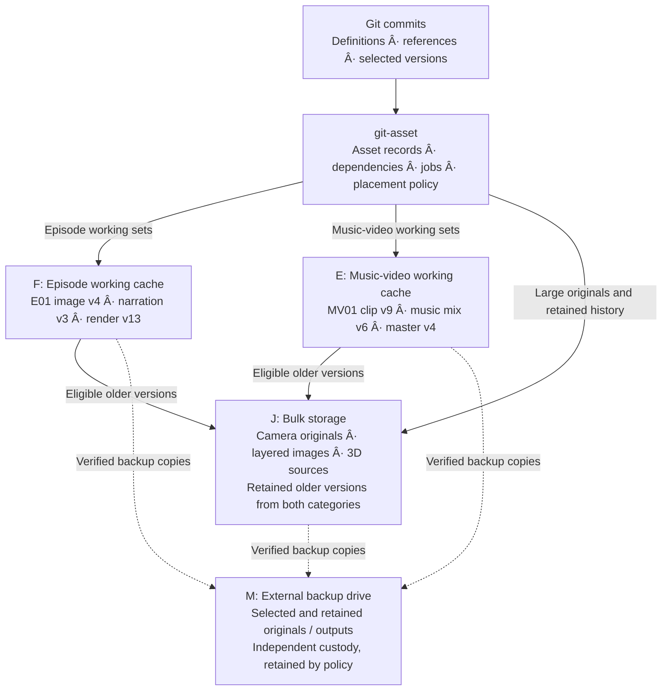
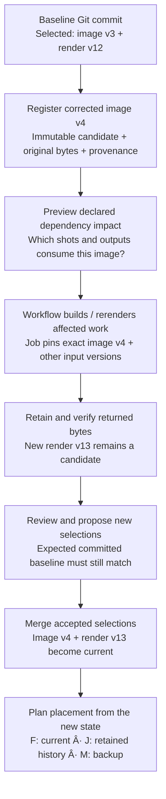

# git-asset

**Track an asset's identity, versions, dependencies and storage policy—with Git
for decisions and git-annex for file bytes.**

git-asset is a CRM-like layer for assets: a durable record of what an asset is,
which version is selected, what uses it, and where its bytes need to live.
Projects define their own asset types, categories and workflow rules.

Experimental: the diagrams describe the lifecycle contract. See
[what works today](#what-works-today) for the qualified implementation scope.

## The story in one minute

A studio produces **episodes** and **music videos**. Its library contains images,
audio, camera originals, 3D sources and rendered outputs. Current work needs fast
access; historical versions and large originals need affordable bulk storage;
retained work needs an independently verified backup.

The team chooses a policy: episode working sets live on **F:**, music-video
working sets on **E:**, bulk originals and retained older versions on **J:**,
and backups on the external **M:** drive. One project can use several locations;
one exact asset version can have copies in several places.

Git records small authored definitions, references and selection history.
git-annex manages the actual file contents, copies and native transfers.
git-asset connects identity, dependencies, active jobs and retention obligations
to the team's placement policy. The team can explain both **what should be where**
and **which copies have actually been verified**.

## Four disks, different jobs

This is an example policy. Drive names, project categories and asset-type rules
are configurable; observed copy availability and custody are recorded separately.



| Example asset or use | Working location | Bulk/history location | Backup |
| --- | --- | --- | --- |
| Episode images, narration and current render | F: | J: for retained older versions | M: |
| Music-video clips, music mix and current master | E: | J: for retained older versions | M: |
| Large camera originals, layered images and 3D source masters | J:; named inputs can be prepared on F: or E: for a job | J: | M: |
| A music cue used by both an episode and a music video | F: and E: when both working sets require it | J: for retained older versions | M: |

The same cue can have one identity and exact content hash while serving both
projects. Asset type, project category, selected version and active job needs
combine to determine placement. A folder or drive letter alone does not establish
independent custody. A configured M: backup is desired placement; verification
and retention evidence establish what is actually protected there.

## Fix an asset, rebuild the affected work

An artist fixes **E01's hero image v3**, producing **v4**. The episode currently
selects image v3 and render v12. The music video is unrelated and keeps its
existing selections.



1. **Register the fix.** Keep the original returned bytes, content hash, byte
   length and provenance. The asset keeps its logical identity; v4 is a new
   immutable version. Registration alone does not select or approve it.
2. **Find the affected work.** Preview the declared dependency closure. A
   consuming workflow such as REEL decides which tasks are invalid and invokes
   the editor, builder or renderer. Missing relationship coverage stays explicit.
3. **Build from exact inputs.** Pin image v4 and the other required input versions
   into the job. Prepare named inputs in an owned workspace and preserve their
   protection through long-running or interrupted work. Advancing another branch
   does not silently change those inputs.
4. **Keep results before finishing.** Record returned output bytes as immutable
   candidates with provenance. Retain and reopen/verify them before declaring
   completion or retiring owned scratch. Creative review stays with the workflow.
5. **Select explicitly.** Review image v4 and render v13, then propose their
   selection against the expected Git baseline. Another writer advancing that
   baseline causes a conflict. Until acceptance, v3 and render v12 remain selected.
6. **Reconcile storage after the merge.** An explicitly enrolled worker can use
   the new commit to request a placement plan. Current episode work belongs on F:;
   eligible older versions belong on J:; backup policy still requires M: evidence.

Old versions stay accessible through exact historical references without changing
current selections. A job, branch or another project can keep an old version in a
working cache. Eviction requires current protection checks and verified retained
custody. Final deletion is a separate explicit retirement decision; losing the
selected label is insufficient.

These diagrams describe the lifecycle contract and product direction. The current
native-annex adapter is qualified for explicit guarded local reads on Windows.
Native ingress, retained publication and participating-pruner execution remain
integration work. Existing local-provider teaching fixtures demonstrate bounded
lifecycle slices; consuming workflows own build execution, rerender decisions and
creative approval. The capability table below defines today's implemented scope.

## Try the public sample

Start with the [sample catalogue course](examples/catalogue/README.md). It uses
portable synthetic assets and real Git/provider checkpoints, compares expected
and observed copies, and exports a catalogue with before/desired/observed lessons.
The complete Git-style course remains in development.

The front door is `git asset` (or `git-asset`), after building the workspace
binaries together:

```text
git asset describe
git asset query describe
git asset sample describe
```

See the [team overview](docs/TEAM-OVERVIEW.md),
[current architecture](docs/ARCHITECTURE.md), [roadmap](PRODUCT_PLAN.md) and
[existing-data compatibility](docs/COMPATIBILITY.md). Opening a repository or
requesting help performs no cache initialization, hydration, transfer or deletion.

## What works today

| Capability | Implemented experimental scope |
| --- | --- |
| Identity and metadata | Immutable objects/trees, bounded persistent metadata and exact Git snapshots |
| Existing stores | Guarded verified reads from configured flat, CAS and Git LFS layouts |
| Git annex | Optional Rust `annex-read` adapter for exact guarded local reads from explicitly enrolled format-10 ordinary/bare repositories on Windows; see [contract](specs/ANNEX-READ-ADAPTER.md) |
| Managed annex reads | [Pool-pinned namespace roster](specs/ANNEX-MANAGED-READ.md) and shared use guards allow owner adoption while blocking participating exclusive pruners |
| Git LFS | Explicit existing-cache download adapter; optional bounded standalone Basic upload with full readback |
| Local storage | Bounded publication, capacity admission, source journals, retention and recovery primitives |
| Optional typed assets | Schema admission, declared graphs, sparse variants, production contexts and revision/delivery history |
| Job resources | [Exact flat job bindings](specs/NATIVE-JOB-PROTECTION.md) for explicit adoption into durable guarded namespaces; metadata obligations remain separate from byte custody |
| Local catalogue | Multi-project works, child navigation, search, versions, metadata coverage and storage comparison |
| Agent queries | Discoverable JSON interface for inspect/admission and profile previews, find, compare, shared bytes, direct bindings and explained transitive impact |
| Storage review | Named copy observations, placement preferences, explicit verification and held dry runs |

These components are not a complete autonomous storage service. Full dependency/job
coverage, end-to-end custody, automatic lifecycle reconciliation, remote transfer
providers and production eviction qualification remain open. The catalogue cannot move or
delete assets. Registration does not prove a remote copy exists.
Read the [safety promise](docs/SAFETY-PROMISE.md).

The [Git lifecycle selection interface](specs/GIT-LIFECYCLE-RECONCILIATION.md)
adds `git-asset-lifecycle describe`, then explicit plan/status/apply/resume for an
enrolled committed ref. It verifies persisted immutable metadata before atomic
desired-claim adoption, preserves predecessors, and separates historical receipts
from current ref observations. Those commands keep storage convergence unknown.
The subsequent [local placement command](specs/PLACEMENT-RECONCILIATION.md),
`git-asset-lifecycle reconcile PROFILE REQUEST PLACEMENT_PROFILE [CURSOR]`, composes
copy, retained backup, handoff, ordinary cache eviction and exact-byte
reacquisition in explicitly enrolled local stores. It processes one bounded page
with private permissions and separate physical observations. A trusted GitHub
trigger, production provider/large-file qualification and full lifecycle coverage
remain required; no runner, hook or live cache is installed automatically.

The optional `git-asset/upload` feature adds [Git LFS upload](specs/LFS-UPLOAD.md)
through `git-asset-lfs upload describe` and an explicitly configured standalone agent.
It authorizes exact OIDs, preserves verified local source bytes and uses bounded
Batch/PUT/verify/full-download readback with existing accounted witnesses.
Private scopes admit credentials; plans contain none. Uploaded availability is
separate from retained backup custody. No live configuration or hooks are installed.

The opt-in [managed local library](specs/MANAGED-REPLICA-RETIREMENT.md) now
supports bounded ordinary replica retirement, cancellation and explicit
reacquisition with retained-survivor and incarnation fences in synthetic stores.
It does not enable live caches, automatic merge actions or final-copy deletion.

The explicit [retirement CLI/agent interface](specs/RETIREMENT-AGENT-CLI.md)
exposes the same mechanism through `git-asset-storage retire describe`, then
plan/status/apply/resume/cancel and explicit reacquisition. Existing managed
roots, reserved capacity and independently admitted private profiles are required;
eviction, cancellation and reacquisition are separately disabled by default.
Historical retirement and current byte availability are reported separately.

The optional [native historical selector](docs/guides/NATIVE-RETIREMENT.md)
uses `git-asset-retirement bind/select` to map exact native blocks and admitted
definition categories to existing bulk selections. Shared objects retain separate
asset bindings. Binding writes metadata only; source adoption and final deletion
need their separate authority. Age filtering is not inferred or enabled.

An optional [S3 upload interface](specs/S3-PUBLICATION.md) uses private presigned
access, conditional PUT and full hash/length readback while preserving the local
source. Build with the git-asset-store `s3` feature and start with `git-asset-storage s3 describe`.
Local intent/completion reuse existing accounted publication. Verified remote
availability does not establish retained backup custody or source-eviction authority.

## Build and try it

Contributors and coding agents: follow [development startup](docs/DEVELOPMENT.md)
and [resume state](context/RESUME.md) to continue from this repo without prior
project-session history. The [roadmap](PRODUCT_PLAN.md) orders the next slices.

Use current stable Rust, Git and Git LFS. Rust 1.98.0 is the recorded local
qualification toolchain; no minimum supported Rust version is fixed yet.
Windows and Linux run in CI. Install Git LFS before integration tests.
No crates.io package or prebuilt installer is published by this repository.

    git clone https://github.com/giodl73-repo/git-asset.git
    cd git-asset
    cargo build --workspace --all-features --bins --locked
    cargo test -p git-asset --features schema --test catalogue --locked

The catalogue tests create synthetic Git repositories and temporary stores.
They need no personal project, credentials or existing cache. Building/testing
installs no daemon or Git hooks.

For your project, create a machine-local resolver profile and catalogue enrollment
using [the catalogue contract](specs/CATALOGUE.md) and
[resolver profile](specs/NATIVE-GIT-RESOLUTION.md). Keep local paths and credentials
outside the source repository. Then run:

    target/debug/git-asset-catalogue check /absolute/path/to/enrollment.json
    target/debug/git-asset-catalogue serve /absolute/path/to/enrollment.json 8799

Compare recorded selected objects across two enrolled projects without rehashing
media or running the server:

    target/debug/git-asset-catalogue shared /absolute/path/to/enrollment.json project-a project-b /absolute/path/to/new-report.json

The private report groups shared SHA-256/length identities with their asset IDs
and pinned commits. An optional final category argument narrows the query.
It covers enrolled native selections; unregistered files, nested inventories and
other streams remain outside this comparison. Zero matches is scoped evidence,
not proof that two entire projects share no media. Output never overwrites a file.
For direct selected/named-stream reference lookup and the distinction between
byte equality and dependency changes, see [meta operations](docs/META-OPERATIONS.md).

Agents can use one versioned interface for these operations:

    target/debug/git-asset-query describe
    target/debug/git-asset-query run /absolute/path/to/request.json

See [agent queries](docs/AGENT-QUERIES.md) for request shapes, coverage, exit codes,
snapshot/interpretation fencing and the Rust library interface.
Use works to discover admitted scopes, then manifest_references for explicit
inventory byte references with document/field provenance. This reads bounded
named JSON metadata through enrolled readers, never referenced media leaves.
manifest_impact traces potential native consumers if matching owner records
change, keeping inventory evidence separate from semantic dependency paths.
In the catalogue, open a record's Impact tab, choose relationships and Trace
consumers to explore exact paths and coverage gaps. Work Overview links to its
source record's impact view.
The Compare tab lets you choose a baseline and compare another registered record
across projects: selected bytes, record/definition identity and field/stream
changes stay separate. Missing selections remain explicitly unavailable.

On Windows append .exe to the binary and supply an absolute Windows path.
Open http://127.0.0.1:8799/; stop the foreground process to stop the viewer.
Startup loads configured Git metadata. Nested document expansion, copy observation
and byte verification are separate explicit actions. There is no automatic
project discovery, cache scan, hydration or eviction.

The runtime and CLIs are Rust. Python is used by development checkers and an older
explicit restore helper, not by the Rust viewer. New restore integrations should
use [the Rust project interface](specs/PROJECT-RESTORE.md).

## The model

| Concept | Meaning |
| --- | --- |
| Object | Immutable bytes identified by hash and length |
| Tree | Immutable logical paths mapped to objects or child trees |
| Bundle | Named collection with exact immutable snapshots, not necessarily an archive |
| Place | Configured location with capabilities and a failure domain |
| Claim | Admitted obligation to retain content at suitable places |
| Plan | Proposed operations to satisfy those obligations |
| Observation | Scoped availability evidence, not automatically verified custody |

    main: 1,000 objects       branch replaces 5       merge selects new version
                             reuses 995              history retains old demand
                             draft protects bytes    shared objects stay shared

    Git merge -> desired state -> scoped plan -> verified provider work
                                              -> authorized retirement

The automatic lifecycle arrows describe intended integration. Current components
do not make every Git operation trigger transfers or eviction.
The optional [GitHub trigger](specs/GITHUB-TRIGGER.md) adds explicit foreground
OIDC intake and bounded placement coordination under private enrollment. Its
Action example is opt-in; external ingress, executor isolation and live provider
adoption require separate qualification.
Explicit [staged-index protection](specs/INDEX-LIFECYCLE.md) adds
`git-asset-lifecycle index` plan/status/apply/resume/reconcile. Conflict alternatives
remain draft byte obligations, with no merged-version or storage-convergence claim.
Explicit [source settlement](specs/SOURCE-SETTLEMENT.md) adds `git-asset-lifecycle settle`
for owned branch-end and staged-to-committed handoff, preserving retained history.

## Learn and contribute

- [Architecture](docs/ARCHITECTURE.md): crates, feature gates, data flow and boundaries.
- [Roadmap](PRODUCT_PLAN.md): implemented slices and remaining milestones.
- [Git-to-git-asset guide](docs/guides/GIT-TO-GIT-ASSET.md), [theory](docs/THEORY.md) and
  [capacity](docs/guides/STORAGE-AND-CAPACITY.md): ASCII walkthroughs.
- [Catalogue](specs/CATALOGUE.md), [Git LFS](specs/LFS-CACHE-INTEROP.md) and
  [existing-byte reads](specs/EXISTING-BYTE-READ.md): implemented contracts.
- [Engineering evidence](docs/vtrace/README.md): scope and limits of verification.
- [Public source review](docs/PUBLIC-RELEASE.md): six-role findings and ongoing release checks.
- [Contributing](CONTRIBUTING.md) and [security](SECURITY.md).

Original git-asset code and ordinary technical documentation are MIT licensed.
See [LICENSE](LICENSE) and [third-party provenance](NOTICE.md).
